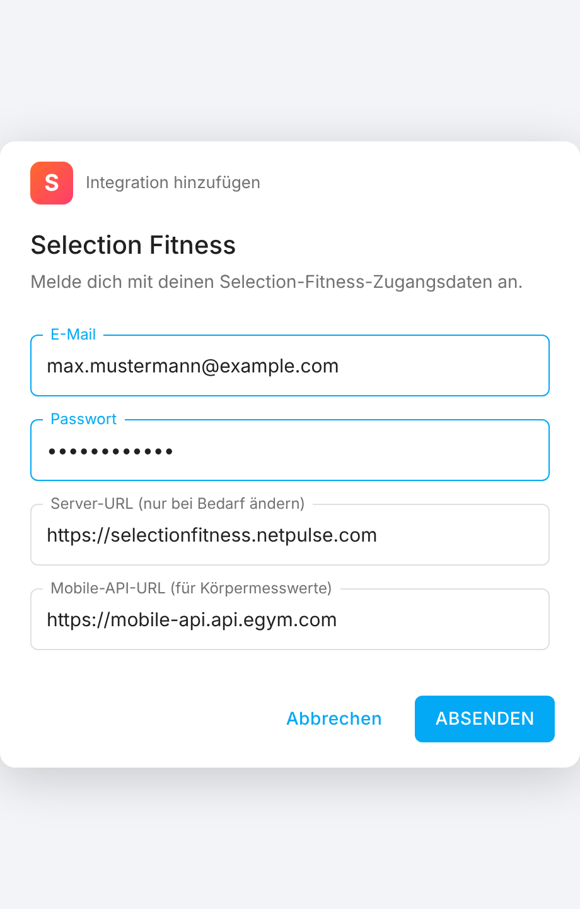
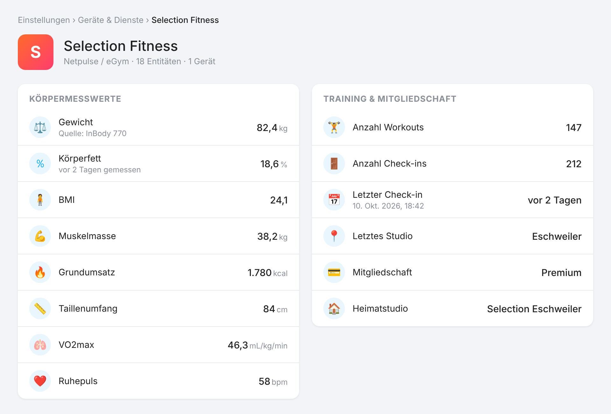

# Selection Fitness → Home Assistant

Eine Custom-Integration, die deine Körper-, Fitness- und Trainingsdaten aus der
**Selection Fitness** App (Netpulse / eGym White-Label,
`com.netpulse.mobile.selectionfitness`) als Entities in Home Assistant abbildet
– ohne MQTT, mit Login direkt in der UI.

Die Integration spricht dieselbe Backend-API wie die App („App-Impersonation"):
Sie meldet sich mit deinen Zugangsdaten an und liest **deine eigenen** Daten.
Es werden keine Schutzmechanismen umgangen.

[](https://my.home-assistant.io/redirect/hacs_repository/?owner=Blogshot&repository=homeassistant-selection-fitness&category=integration)

> Ein Klick auf den Button öffnet das Repository direkt in HACS auf deiner
> Home-Assistant-Instanz.

---

## Funktionsumfang

- **Körperdaten** aus dem Profil: Gewicht, Größe, Geschlecht, Maßeinheit, Heimatstudio
- **eGym BioAge / Fitness-Alter**: Körperalter, Kraft-/Muskelalter, Cardio-Alter,
  Flexibilitätsalter, Stoffwechselalter – inkl. Oberkörper-/Rumpf-/Unterkörper-Alter
  und den Muskel-Balance-/Dysbalance-Zuständen
- **Werte hinter dem BioAge**: Körperfett, BMI, VO2max, Ruhepuls, Blutdruck,
  Taille-Hüft-Verhältnis
- **Körperanalyse-Waage im Studio** (InBody / fithub): Muskel-, Mager- und
  Fettmasse, viszerales Fett, Grundumsatz, Körperwasser (intra-/extrazellulär,
  ECW/TBW), Phasenwinkel und Segmentwerte für Arme, Beine und Rumpf – inkl.
  Normbereich als Attribut und rückwirkender Historie
- **Training**: Anzahl Workouts, letztes Training, Trainingsplan, Übungen im letzten Training
- **Pro Gerät** (eGym-Maschinen): ein Sensor je Gerät mit der gewählten Haupt-Metrik,
  **Geräte-Bild**, Trend & Prognose, und allen weiteren Werten als Attribute
- **Kraftmessung je Gerät**: der feste eGym-Testwert (unabhängig vom eingestellten
  Gewicht) inkl. Fortschritt/Veränderung – als Attribut und als wählbare Haupt-Metrik
- **Rückwirkende Historie**: die Geräte-Werte werden als HA-Langzeitstatistik
  importiert → volle Verlaufs-Graphen, auch für die Zeit vor der Installation
- **Mehrere Personen**: jeder Account ist ein eigener Eintrag mit eigenem
  Geräte-Set; Geräte-/Entity-Namen werden pro Person benannt
- **Messwerte zurückschreiben**: Gewicht, Körperfett, Ruhepuls, Blutdruck und
  VO2max per Service ins Konto senden – mit echtem Messzeitpunkt, z. B. von
  einer Waage in Home Assistant

Es werden nur Sensoren angelegt, für die dein Account auch Daten liefert.
Aktualisierung alle **30 Minuten** (`DEFAULT_SCAN_INTERVAL` in `const.py`).

---

## Screenshots

> ⚠️ **Beispielansichten (Mockups) mit illustrativen Werten** – keine echten
> Messdaten. Sie zeigen nur, wie die Integration in der Oberfläche aussieht.

| Login-Dialog | Geräteseite mit Entities |
|---|---|
|  |  |

---

## Installation

### Über HACS (empfohlen)

1. Auf den **„Open in HACS"-Button** oben klicken (oder in HACS →
   *Benutzerdefinierte Repositories* → `Blogshot/homeassistant-selection-fitness`,
   Kategorie *Integration*).
2. *Selection Fitness* herunterladen, Home Assistant **neu starten**.
3. **Einstellungen → Geräte & Dienste → Integration hinzufügen** → *Selection Fitness*.
4. **E-Mail** und **Passwort** eingeben. Die URL-Felder bleiben in der Regel auf
   den Vorgaben.

Für eine **zweite Person** die Integration einfach erneut hinzufügen und die
anderen Zugangsdaten eingeben – es entsteht ein getrenntes Geräte-Set.

### Manuell

Ordner `custom_components/selection_fitness/` ins HA-Config-Verzeichnis kopieren
(`<config>/custom_components/selection_fitness/__init__.py`), neu starten, dann
wie oben hinzufügen.

---

## Konfiguration: Haupt-Metrik pro Gerät

Über **Einstellungen → Geräte & Dienste → Selection Fitness → Konfigurieren**
lässt sich wählen, welche Metrik der Geräte-Sensor als **Status** zeigt:

- **Gewicht** (gestemmtes Gewicht, Standard)
- **Kraftmessung** (fester eGym-Testwert, unabhängig vom eingestellten Gewicht)
- **Kalorien**
- **Aktivitätspunkte**
- **Wiederholungen**

Die jeweils anderen Werte bleiben als **Attribute** am Sensor verfügbar
(`weight_kg`, `reps`, `sets`, `calories`, `activity_points`, `strength_value`,
`strength_progress`, `strength_change_pct`, `strength_measured_at`, `trend`,
`trend_per_month`, `projected_next`, `last_trained`, `session_count`,
`training_method`, `source`, `exercise_code`). So kann jede Person die für sie
relevante Größe als Hauptwert nutzen – manche das gestemmte Gewicht, andere die
Kraftmessung, andere die Kalorien.

---

## Entities (Auswahl)

**Körper & BioAge:** `…_gewicht`, `…_koerpergroesse`, `…_geschlecht`,
`…_koerperalter`, `…_kraftalter`, `…_cardio_alter`, `…_flexibilitaetsalter`,
`…_stoffwechselalter`, `…_oberkoerper_alter`, `…_rumpf_alter`,
`…_unterkoerper_alter`, `…_oberkoerper_balance`, `…_koerperfett`, `…_bmi`,
`…_vo2max`, `…_ruhepuls`, `…_blutdruck_systolisch`, …

**Körperanalyse (Waage):** `…_muskelmasse`, `…_fettmasse`, `…_koerperwasser`,
`…_phasenwinkel`, `…_grundumsatz`, … – jeweils mit `measured_at`, `source` und,
sofern die Waage ihn liefert, `normal_low`/`normal_high`. Die zehn Segmentwerte
(Fett/Magermasse je Arm, Bein und Rumpf) werden angelegt, sind aber standardmäßig
deaktiviert.

**Training:** `…_anzahl_workouts`, `…_letztes_training`,
`…_letzter_trainingsplan`, `…_uebungen_im_letzten_training`

**Pro Gerät:** `…_<geraetename>` (z. B. `…_egym_beinpresse`) mit Haupt-Metrik,
Bild, Trend/Prognose und allen Werten als Attribute.

Die Namen tragen den Vornamen der Person als Präfix, sodass bei mehreren
Accounts nichts kollidiert.

---

## Historie, Trend & Prognose

- **Verlauf:** Home Assistant zeichnet jeden Sensor ab Installation automatisch
  auf. Zusätzlich werden die **Geräte-Werte rückwirkend** als Langzeitstatistik
  importiert – das gestemmte Gewicht aus der Workout-Historie **und** die
  **Kraftmessungshistorie** je Gerät (eigener eGym-Endpunkt). So sind die
  Verlaufs-Graphen sofort rückwirkend gefüllt.
- **Fitness-Alter rückwirkend:** Körper-, Kraft-, Cardio-, Stoffwechsel- und
  Flexibilitätsalter werden über den `bioage/history`-Endpunkt bis zur ersten
  Messung (oft mehrere Jahre zurück) als Langzeitstatistik importiert.
- **Jahresweise Abfrage:** Der eGym-Server liefert pro Anfrage nur ein Jahr
  (die App schaltet zwischen Jahren um). Die Historie wird daher Jahr für Jahr
  abgefragt und zusammengeführt – mit Früh-Stopp nach zwei leeren Jahren.
- **Duplikatfrei:** Statistiken sind pro `(statistic_id, Stunde)` eindeutig; der
  Import ist ein Upsert (überschreibt denselben Stundenbucket), daher entstehen
  beim 30-Minuten-Pull **keine Duplikate**.
- **Trend/Prognose:** je Gerät wird aus den letzten Sessions eine lineare
  Regression gebildet (`trend`: steigend/fallend/stabil, `trend_per_month` in
  Einheit/Monat, `projected_next` als grobe Prognose des nächsten Werts).

---

## Messwerte senden (Services)

> ⚠️ Gesendete Werte landen dauerhaft im Selection-/eGym-Konto und fließen in
> die BioAge-Auswertung ein. Die API bietet **keine Möglichkeit, Messwerte
> wieder zu löschen** – vor allem bei rückwirkenden Werten vorsichtig sein.

| Service | Felder |
|---|---|
| `selection_fitness.add_body_measurement` | `weight` (kg), `body_fat` (%), `height` (cm) |
| `selection_fitness.add_cardio_measurement` | `resting_heart_rate` (bpm), `systolic` + `diastolic` (mmHg), `vo2max` |

Beide akzeptieren optional `measured_at` (Standard: jetzt) und
`config_entry_id` (nur nötig bei mehreren Konten). Ohne `height` wird die
Größe aus dem Profil mitgesendet, sonst würde der Server sie selbst ergänzen.

**Rückwirkende Körperwerte:** Der Server übernimmt jedes gesendete Gewicht als
*aktuelles* Profilgewicht – auch wenn `measured_at` in der Vergangenheit liegt.
`add_body_measurement` lehnt deshalb Werte ab, die älter als die neueste
bekannte Messung sind. Mit `force_backdate: true` werden sie trotzdem gesendet;
danach erscheint eine Benachrichtigung, und das aktuelle Gewicht muss neu
eingetragen werden. Cardio-Werte sind davon nicht betroffen.
In der App erscheinen die Werte mit der Quelle „Home Assistant / HealthConnect“.

Beispiel-Automation für eine Waage:

```yaml
triggers:
  - trigger: state
    entity_id: sensor.waage_gewicht
conditions:
  - condition: template
    value_template: "{{ trigger.to_state.state | is_number }}"
actions:
  - action: selection_fitness.add_body_measurement
    data:
      weight: "{{ trigger.to_state.state | float }}"
      measured_at: "{{ trigger.to_state.last_changed }}"
```

---

## Wie es funktioniert (Reverse Engineering)

Analyse der APK (v1.7, Build 119).

### Auth
- **Login:** `POST https://selectionfitness.netpulse.com/np/exerciser/login`,
  **form-urlencoded** mit `username=<email>&password=<passwort>`.
  (Feldname ist `username`, nicht `login`; Body ist form-encoded, nicht JSON.)
- Antwort liefert `uuid` und setzt `Set-Cookie: JSESSIONID=…`.
- **Autorisierung** aller weiteren Requests = dieser `Cookie: JSESSIONID=…`.
  Kein API-Key, kein Secret, keine Play-Integrity-Prüfung.

### Pflicht-Header
```
X-NP-User-Agent: clientType=MOBILE_DEVICE; devicePlatform=ANDROID; deviceUid=<uuid>; applicationName=SelectionFitness; applicationVersion=1.7; applicationVersionCode=119
X-NP-API-Version: 1.5
X-NP-APP-Version: 119
```

### Endpunkte
Haupt-Host `https://selectionfitness.netpulse.com`:
- `GET /np/exerciser/{uuid}/profile` – Profil (inkl. weight, height, gender …)
- `GET /workouts/api/workouts/v2.3/exercisers/{uuid}/workouts?completedAfter=…&completedBefore=…&languageCode=de`
  – komplette Trainingshistorie (`{workouts:[{completedAt, workoutPlanLabel,
  exercises:[{name, exerciseCode, source, attributes:{calories, activity_points,
  sets_of_…:[{reps,weight}]}}]}]}`)

eGym-Mobile-API-Host `https://mobile-api.int.api.egym.com`:
- `GET /analysis/api/v1.0/exercisers/{uuid}/bioage?types=strength,cardio,metabolic,flexibility&languageCode=de`
  – BioAge-Summary (`totalDetails`, `muscleDetails`, `cardioDetails`,
  `flexDetails`, `metabolicDetails`, je mit `{value}`-Werten)

Datumsformat der App: `yyyy-MM-dd'T'HH:mm:ss.SSSZZZZZ` (numerischer Offset).

### Schreiben (Health-Connect-Sync der App)
- `POST {mobile}/connected-app-measurements/api/v1.0/exerciser/{uuid}/bmi`
  – JSON `{appName:"healthConnect", originalSource, timezone, completedAt,
  weight(kg), height(cm), bodyFat(%)}`, leere Felder werden weggelassen
- `POST {mobile}/connected-app-measurements/api/v1.0/exerciser/{uuid}/cardio`
  – analog mit `bpm`, `systolic`, `diastolic`, `vo2max`
- `completedAt` im Format `yyyy-MM-dd'T'HH:mm:ss.SSSSSS` ohne Offset. Die App
  formatiert in UTC, der Server wertet den Wert aber als **Ortszeit** der
  Zeitzone in `timezone` aus – die Integration sendet daher Ortszeit.
- Antwort `200` mit leerem Body, Messwerte haben keine ID; die App kennt
  keinen Lösch-Endpunkt für Messwerte.

---

## Bekannte Einschränkungen

- **Check-ins / Studiobesuche:** liefern `Membership not found`, wenn der Account
  serverseitig keinen Mitgliedschafts-Datensatz hat – die betreffenden Sensoren
  erscheinen dann nicht. Das ist account-/brandseitig, nicht durch die
  Integration lösbar.
- **Positives/negatives Bewegungsgewicht:** eGym-Trainingsmethoden (`regular`,
  `negative`, `isokinetic`, `adaptive`, `explonic`) können pro Trainingswoche
  unterschiedliche Gewichte für die positive/negative Phase bedeuten. Die API
  liefert pro Satz ein `weight`; das Feld `training_method` wird als Attribut
  mitgeführt, sofern vorhanden. Eine getrennte pos/neg-Auswertung ist als
  Erweiterung vorgesehen.
- **Kraftmessung vs. gestemmtes Gewicht:** die gezeigte Haupt-Metrik ist frei
  wählbar (siehe oben), da je nach Nutzer das gestemmte Gewicht, die Kalorien
  oder die Kraftmessung relevanter ist.

---

## Hinweise

- Lesend, bis auf die Services oben – geschrieben wird nur, wenn du einen
  Service aufrufst.
- Session-Cookies laufen serverseitig ab; die Integration meldet sich bei `401`
  automatisch neu an.
- Nur für den eigenen Account gedacht.
